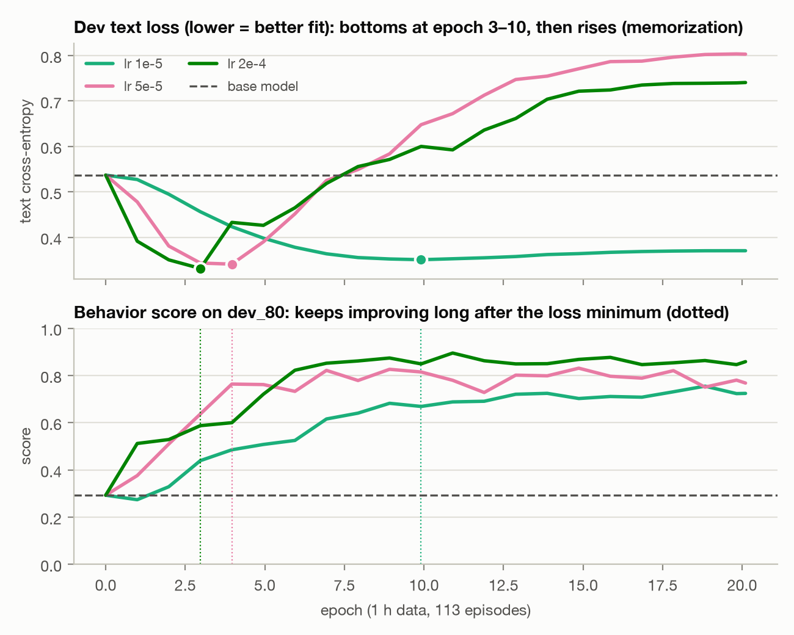
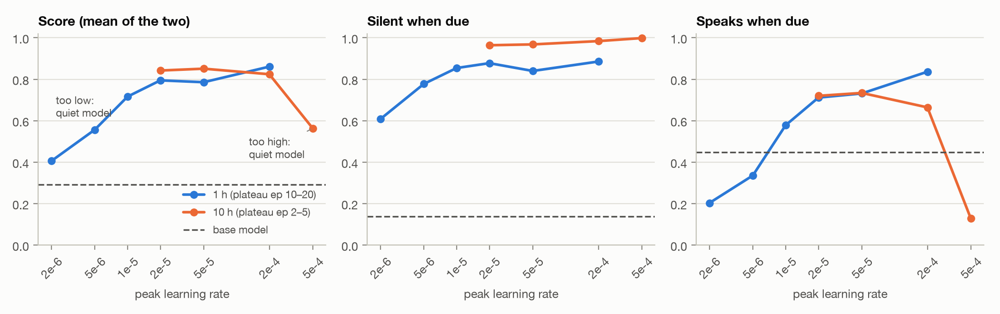
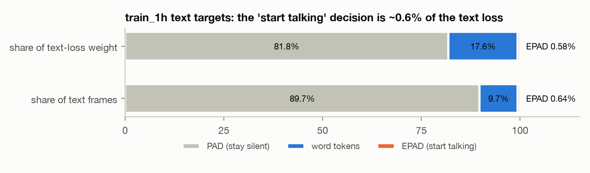
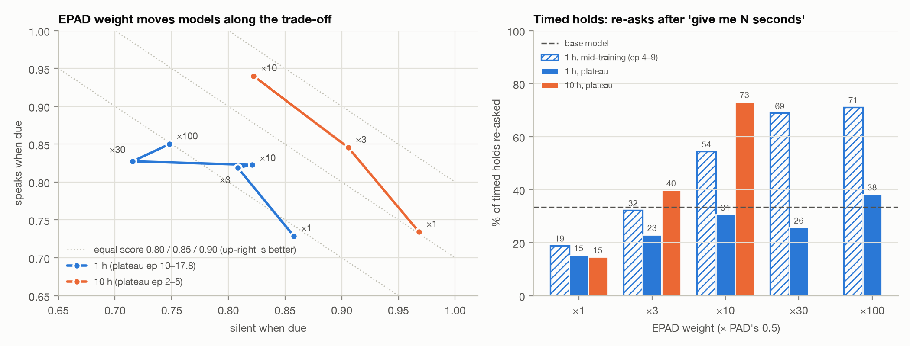
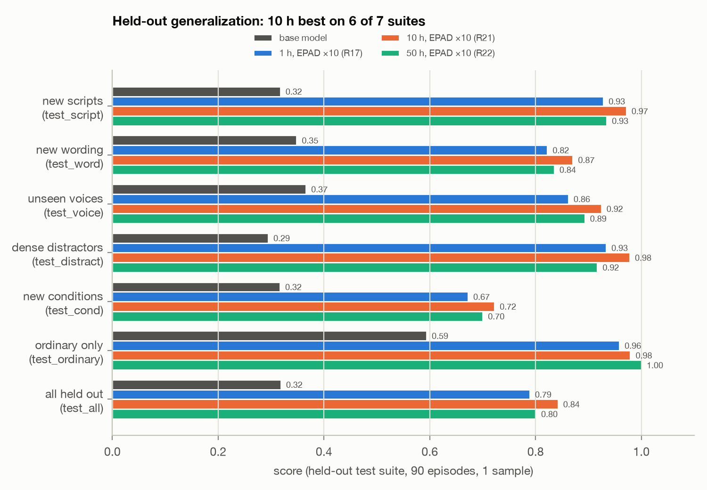
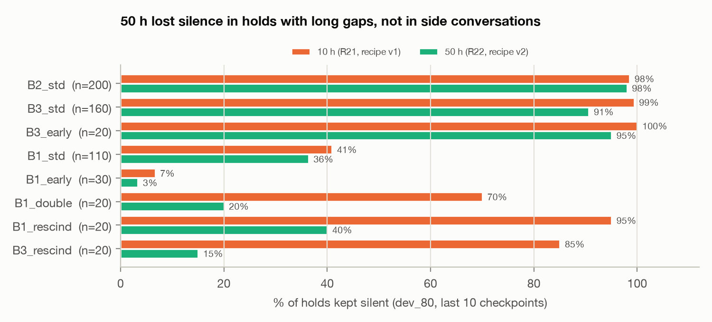
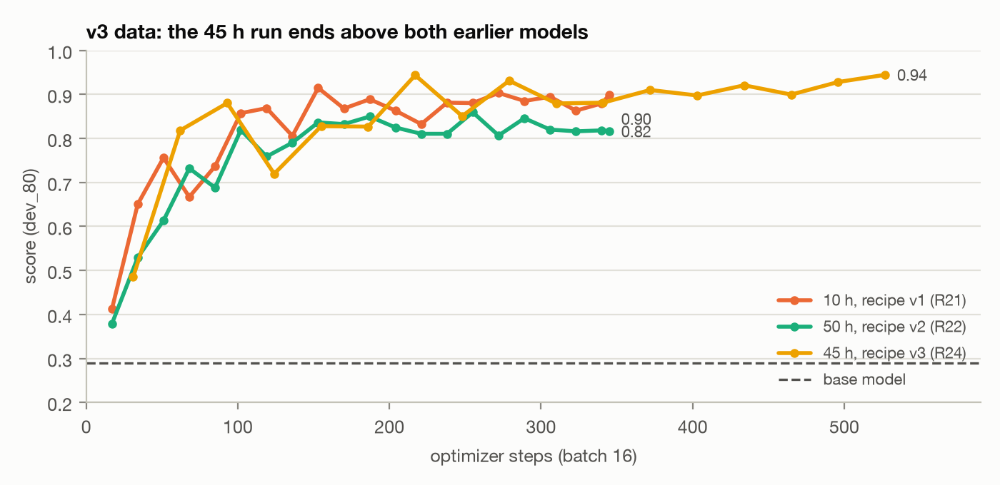
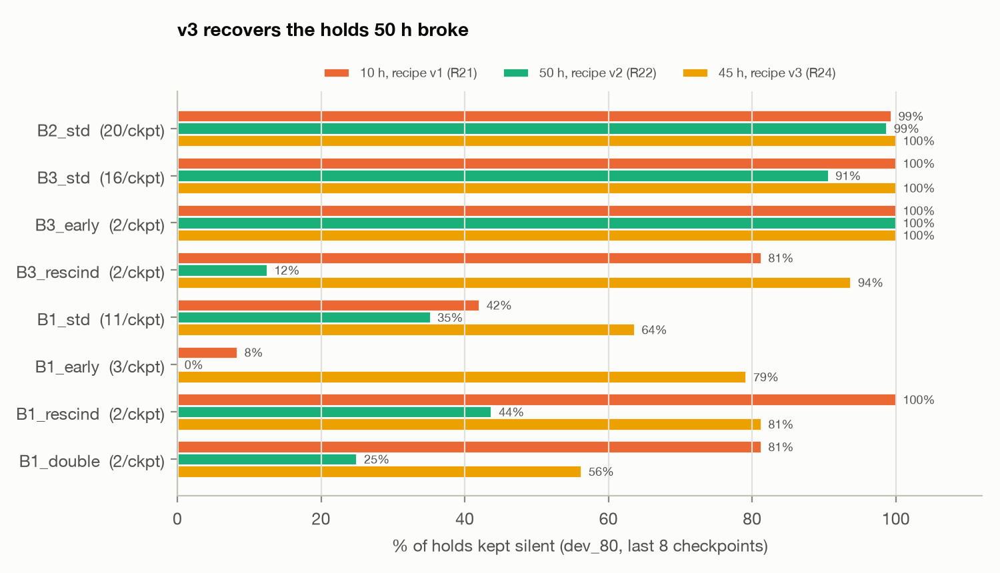
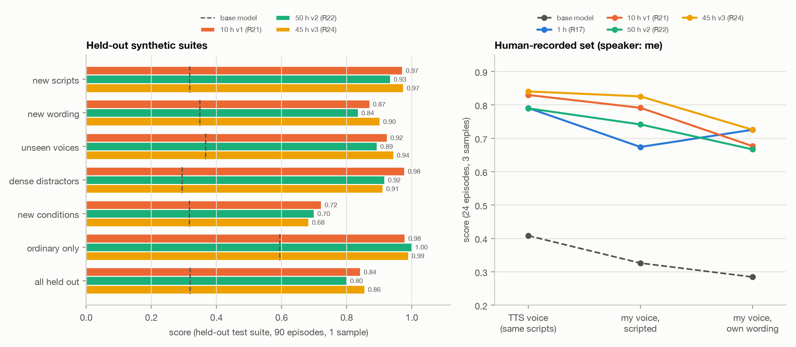

# Project Report - Jaewoo Park Work Trial

## 1. Dataset

I used synthetic data that could capture the desired behavior across three cases:
- “Give me N seconds to think, then ask me again.”
- “I’m going to talk to my friend. Stay quiet until I tell you I’m back.”
- “Let me describe all three options before you comment.”
Essentially, I hoped that these examples are sufficient for the model to learn proper intervention timing. The dataset consistts of stereo conversations ≤ 60s that follow Moshi's input structure (left: Moshi; right: user + friends + noise).

Below is the pipeline I used (6 stages).

| Stage | What happens | Key settings | 
|---|---|---|
| **1. Scripts** | Sonnet 5.5 (effort: low) writes the script of each conversation according to certain conversation templates. I set 29 conversation themes (e.g., "school", "work") and 10 user speaking styles (e.g., "short and to the point, in brief sentences"). | 2,500 scripts in ~5 min. |
| **1a. Filters** | Rejects scripts that open with Moshi, leave a question unanswered, lack a return-cue lookalike, run past 57 s, use hard-to-pronounce words or brands, or near-duplicate an accepted script | Content-word similarity ≥ 0.6 counts as a duplicate; a speaking rate of 0.28 s/word fits the length | | |
| **1b. Split** | 15% of scripts go to test, decided by a hash of the script | `sha1(text) % 1000 < 150` | | |
| **2. Episode plan** | Takes the next unused script and lays out a timeline. | Turn gaps lognormal × 1.5; Moshi replies after 0.45–1.35 s; N (for reply after N seconds) ∈ {3, 5, 10, 15, 20, 30} s; side-conversation stalls 2–8 s; option pauses 3–5 s; fillers in half the timed holds | Content and wording are separate, so a test suite can swap only the wording (20 train / 6 test instruction phrasings, for example) | `<id>.spec.json` |
| **3. Speech** | Renders each line with Pocket TTS (cheap, fast, same company as Moshi), then corrects its timing | 16 training voices, 4 held out for testing; ~12× realtime on the laptop | Holding out voices tests generalization to new speakers. The timing fixes keep Moshi's text aligned with its audio to ±0.04 s |  |
| **4. Mix** | Places every clip on the timeline and mixes two channels | Speech at −20 dBFS; the friend 4–9 dB quieter with room reverb; noise only on the user side | Moshi's channel is exact silence during holds, which is the target behavior. The friend sounds like a second person in the room | `<id>.wav` (stereo, 24 kHz) |
| **5. Labels + checks** | Writes Moshi's word timings (the only text the model is trained on) and every hold, release and distractor time; then verifies the episode | Fails on noise in a hold, misalignment > 0.15 s, a timer off by > 0.3 s, a missing EPAD before a resume, overlap, or > 60 s | Catches generator bugs before they become training data. The event labels drive the evaluation later | `<id>.json`, `checks.json` (1,150 / 1,150 pass) |
| **6. Sets** | Cuts nested subsets by total audio and counts what's unique | `train_1h` = first 113 episodes; `train_10h` = first 1,101 | 1 h ⊂ 10 h, so the only difference is more data. Unique data is reported separately from repetition | `train_1h.jsonl`, `train_10h.jsonl`, `ledger.json` |

The same pipeline builds the dev (validation) set (unused training scripts, screened for overlap) and the 7 test sets (test scripts,
with test wording, test voices or new conditions switched on per suite). Only the flags change.

### Decisions

- **Three target behaviors, plus ordinary conversation so the model keeps answering:**
  - *Timed hold* ("give me ten seconds, then ask me again");
  - *Side conversation* ("stay quiet until I'm back");
  - *Hear me out* ("let me describe all three options");
  - ordinary and decoy conversations: decoys use hold-like words with no hold intent, e.g. "I just got back from Boston".

  Mix: 15 / 25 / 20 / 40%. Thought timed hold would be the easiest to learn, but *it turns out this was not the case*.
- **Contrast episodes** so the model follows the instruction rather than "going deaf for a while":
  - the user answers early;
  - the user cancels the hold;
  - two holds in one conversation;
  - the user finishes the list early.
- **Distractors written by the LLM, in context.**
  - The first version inserted distractor lines from a fixed list. This caused scripts that didn't make sense. 
  - Distracting lines are LLM generated now. 
- **Listening drove four generator changes:**
  - **The user always speaks first.** Every window had opened with Moshi talking, which teaches "Moshi starts
    talking".
  - **Gaps ×1.5**: turns felt rushed.
  - **No brand names/hard words**: the TTS said "MacBook" wrong.
- **Don't train Moshi to sound like the TTS.**
  - Moshi's side is a TTS voice, so we masked the audio loss on Moshi's speech frames.
  - This choice comes back in §5: it makes the audio loss see *only* silence.

### Extending to 10 h

- **10 h is built as a superset of 1 h**: first-K prefixes of one 1,150-episode build, cut by total audio. So
  `train_1h` ⊂ `train_10h`, and no script repeats.
- **"10 h" means 10 h of total conversation audio**, not 10 h of speech (7.05 h is speech, 3.73 h requested
  silence). Unique episodes, hours and training exposure are tracked separately (`ledger.json`).

| Set | Unique Episodes | Total h | Moshi speech h | Requested silence h |
|---|---|---|---|---|
| train_1h | 113 | 1.01 | 0.25 | 0.39 |
| train_10h | 1,101 | 10.01 | 2.48 | 3.73 |

---

## 2. Evals

### Decisions

- **Score** "Silent when due" alone rewards a model that never talks; the model is scored based on being *silent when due* and *speaks when due*, and the score is their mean. Score = mean of *silent when due* frames (requested holds kept silent) and *speaks when due* frames (resumes and answers when
it should). Numbers are on dev_80 (80 unseen conversations, training voices and wording) unless stated. The base model
scores 0.29.
- **Force the script outside the scored windows.**
  - Outside each hold's window, Moshi's text and audio are set to the script; inside, the model runs free.
  - **Why:** otherwise one early mistake changes the rest of the conversation, and only the first hold is scorable.
    With forcing, every hold gets scored.
- **Thresholds fixed before any model was scored:**
  | Rule | Value |
  |---|---|
  | Grace period for ack ("Okay, understood" from Moshi after user is done giving command) | 2.5 s |
  | Hold violation | ≥ 1 s of speech or > 3 words |
  | Resume / answer window | 3 s |
  | Timed-hold tolerance | max(1.5 s, 0.2·N) |
- **Dev sets**
  - **dev_80 ⊂ dev_200**: unseen scripts with new training voices and wording. Used for every checkpoint and for model
    selection.
  - 80 episodes was a deliberate choice, since a 200-episode eval for something trained on 100 examples and for initial pruning is overkill.
- **Test sets**
  - 7 held-out test suites × 90 episodes, each holding out one axis: new scripts, new wording (incl. new hold
    durations), unseen voices, dense distractors (incl. the *friend* saying "I'm back"), new conditions (keyword
    release, phone call, "a minute"), ordinary only, and everything new at once.
  - Test suites are run once on the final models, never for selection.

---

## 3. Training on the 1h set: LR pruning

**Setup:**
- LoRA (rank 64) on `kyutai/moshiko-pytorch-bf16`, with the same checkpoint, seed and data order for every run.
- Batch 16 × 60s window; OneCycle schedule.

### How the training loss is computed

moshi-finetune trains Moshi the way it was pretrained: predict its own next text token and audio tokens, given
everything heard so far.

- **Input.**
  - Each 60 s episode becomes 750 frames at 12.5 Hz.
  - Both channels are encoded by Mimi into 8 audio codebooks per frame.
  - The model is teacher-forced: at each frame it sees the true history of the user's audio, its own audio, and its
    own text.
- **What it predicts:** only Moshi's side.
  - Per frame, Moshi's **text token** and its **8 audio tokens**.
  - The user and friend audio is input only and is never predicted. Only Moshi's words become text targets.
- **Text targets.**
  - Moshi's words are tokenized and placed starting at the frame where each word begins.
  - Every other frame is **PAD** ("stay silent").
  - The frame just before Moshi starts speaking after a silence is **EPAD**: the "start talking now" decision.
- **Text loss.** Cross-entropy per frame, averaged with weights: word tokens 1, PAD and EPAD 0.5
  (`text_padding_weight`).
- **Audio loss.** Cross-entropy over Moshi's 8 audio codebooks, weighted 100 for the first (semantic) codebook and 1
  for each of the other seven. So ≈ 93% of the audio loss is the semantic codebook.
- **Total loss = text loss + audio loss.**
  - The optimizer (AdamW) normalizes gradient scale, so the weights change what the model emphasizes, not how big
    its steps are.

**Changes I made to the loss** (small patches to moshi-finetune):
1. **Audio mask.** No audio loss on Moshi's speech frames, from 0.08 s before each word to 0.24 s after. Moshi's
   voice in our data is TTS, and I didn't want it to learn that voice. As a side effect, the audio loss is computed
   only on Moshi's *silent* frames (§5).
2. **Ignore the padded tail.** Episodes shorter than 60 s are padded to the window. Upstream counted those padded
   text frames as PAD targets, ~46% of all text frames at 1 h, which would teach silence for free. They're
   ignored.
3. **A separate EPAD weight** (`text_epad_weight`; added later, §5), for training only.

**Dev loss.**
- The same calculation, with the original weights, on all 200 dev conversations at every checkpoint. Text and audio
  are logged separately.

### Decisions

- **20 epochs**, with a checkpoint and evaluation every epoch.
- **LR sweep**: {2e-6, 1e-5, 5e-5, 2e-4, 5e-4}.
- **Every checkpoint saved and scored**: 21 per run, so we can see *when* behavior appears, not just where it ends.
- **Prune on evidence, mid-run.**
  - By epoch ~13, 5e-5 and 2e-4 had memorized the 113 scripts: train text loss ≈ 0.01, dev loss doubling.
  - We dropped the unstarted 5e-4 run and kept the two nearly finished ones.
  - During training, we added 5e-6 and 2e-5 where the decision boundary was.
  - Evals showed that 2e-4 performed the best in practice, despite having a high dev loss; thus, I ended up testing 5e-4 for the 10h run instead.

*Dev text loss bottoms at epoch 3–10 and then rises as the model memorizes wording, but behavior keeps improving long
after. The lowest-loss checkpoints mostly never speak again (audible in the demo).*

- **Too low an LR gives a quiet model.** 2e-6 and 5e-6 learn "stay silent" but not "speak again": ordinary questions
  answered fall to 10%, while their dev loss looks *better*.
- **Learning has two phases.** Every run learns silence first, then when to speak. Low LRs never leave the first phase.

**Result at 1 h:** 2e-4 is best (plateau score 0.86: silent 89%, speaks 83%, ordinary questions 98%). The behavior is
a plateau with no degradation through 20 epochs, even as the loss blows up.

---

## 4. Training on 10h

### Decisions

- I ran {2e-5, 5e-5, 2e-4 and 5e-4}.
- 5 epochs, a checkpoint every ¼ epoch: at 1 h, behavior plateaued after ~50–70 steps, which is inside 10 h's
  first epoch. So 10 h needed fine-grained checkpoints, not more epochs.

*Plateau averages by peak LR. At 10 h the best LR moves down to 2e-5–5e-5. Too high an LR (5e-4) collapses into the
same quiet model as too low an LR at 1 h.*

**Result:**
- The 10h models, in practice, refused to talk, and would often ignore user queries, despite having good loss. 
- Timed holds were never learned: models re-asked after "give me N seconds" only 8–20% of the time, *below* the
  base model's 33%.

Under our current loss, the dataset itself seemed to be encouraging silence.

---

## 5. Changing EPAD

- ~90% of Moshi's text targets are PAD ("stay silent").
- The EPAD token, which marks the frame right before Moshi starts talking (the decision we care about), is
  0.64% of frames and **0.58% of the text loss**. It shares PAD's down-weighting of 0.5.
- The audio loss covers only Moshi's *silent* frames, because of the TTS mask from §1. So every audio gradient says
  "be silent".

### Adjusting

- **I added a patch to moshi-finetune: a separate loss weight for EPAD**, for training only. The dev loss keeps the
  original weighting so it stays comparable.
- I fixed LR = 5e-5 and one dataset (1 h), varying only the EPAD weight: ×3, ×10, ×30, ×100.
- ×30 and x100 looked best on re-asks, but it was talking through 75% of the holds. The model was too chatty.
- I then trained two models on the 10h dataset: EPAD {x3, x10}, with LR 5e-5.

*Left: at 1 h, EPAD weight slides the model along the silence/speech trade-off (score flat ≈ 0.80). At 10 h it is a
real gain (0.85 → 0.88). Right: timed re-asks appear mid-training at 1 h but fade; at 10 h with ×10 they stick (73%).*

**Result:**
- **10 h + EPAD ×10 became the best model:** plateau 0.88, best checkpoint 0.91.
- It re-asks after timed holds 73% of the time, vs 15%.
- The cost is premature speech *inside* timed holds, as the model is slightly chatty. Side-conversation and hear-me-out holds stay 97–99% silent. 
- This suggests that for a high EPAD, the hold behavior is the most difficult, which is why I tweaked the distribution for the following 50h run. 
- I ended up scrapping the idea of a 100h run because of compute concerns, and instead opted for 50h. 

---

## 6. 50h training

### Decisions

- **Scale and diversify at once:**
  - 5,164 new scripts, screened in reverse against dev and test so nothing leaks;
  - user and friend voices from three TTS engines: 63 voices vs 16 (Pocket 40% / ElevenLabs 15% / Fish 45%);
  - **more timed holds** (25% vs 15%) with fillers in 70% of them, aimed at the one unlearned behavior.
- LR = 5e-5, EPAD x 10. 
- Only 1 epoch, just to see how more diverse data affects training vs the 10h models, while keeping compute constant.

After training, I ran the test suites from the eval section on {base, 1h + EPAD×10, 10h + EPAD×10, 50h + EPAD×10}.

### What happened

**10 h was best on 6 of 7 held-out suites.** 50 h was 2–6 points lower on those six; 1 h was 2–6 points lower on all seven. 

### Diagnosing 50 h

- **Data observed:**
  - hear-me-out cancelled: 85% → 15%;
  - two timed holds: 70% → 20%;
  - timed hold cancelled: 95% → 40%.
- Side conversations were unchanged at 98%, so the new voices weren't the cause.

I concluded that the model had become too talkative. The holds that broke all contain long stretches where nobody talks to Moshi but Moshi must keep waiting: the gap after a cancel, the pause between two timed holds, pauses inside a long hear-me-out. Side conversations don't have this, because there's constant chatter between the humans.

Here are some causes that I diagnosed. 
- Ramping up the timed hold percentage to 25% ("ask again after N seconds") fills the dataset with examples where Moshi breaks the silence with no cue. 
- The silences in other holds are short, with most of them lying under 10 seconds. There are no examples of long silences where the right move is to keep waiting. 
- EPADx10 emphasizes the importance of breaking the silence. 

So, Moshi learned to start talking after a few seconds of quiet. I made the following changes to the 50h dataset. 

- **Fix 1:** timed holds are back at 15% (no new audio). I ended up dropping around ~5h of timed hold audio. 
- **Fix 2:** add long silences inside cue-released holds: side-conversation stalls up to 20 s, hear-me-out pauses up to
  12 s. Silence alone should stop predicting "speak now". This is timing-only: all audio is reused, and there are 0
  new TTS clips.
- **Keep EPAD ×10**, since it's what made the timed re-ask stick. Train ~1.5 epochs, with checkpoints throughout so we
  can pick an earlier one.

### What happened

| dev_80 | 10 h v1 (R21) | 50 h v2 (R22) | **45 h v3 (R24)** |
|---|---|---|---|
| Score, mean of last 8 checkpoints | 0.89 | 0.82 | **0.91** |
| Final checkpoint (silent / speaks) | 0.90 (84% / 95%) | 0.82 (69% / 94%) | **0.94 (97% / 92%)** |
| Timed re-ask (last 8) | 76% | 74% | 70% |

R24's final checkpoint is also its best. Text dev loss settled at 0.296–0.298 from step ~310, the lowest of any run.

**The holds 50 h broke came back:**
- hear-me-out cancelled: 12% (R22) → 94%;
- two timed holds: 25% → 56%;
- timed hold cancelled: 44% → 81%.

Timed holds improved too, even beyond R21:
- standard: 42% (R21) → 64%;
- answered early: 8% → 79%.

Side conversations stayed at 99–100%.

**Human-recorded set.** At this point, I recorded the user side of 24 held-out conversations myself. The friend and Moshi stay TTS, and each episode was scored over 3 samples.

| Held-out suite | 10 h v1 (R21) | 50 h v2 (R22) | **45 h v3 (R24)** |
|---|---|---|---|
| new scripts | **0.97** | 0.93 | **0.97** |
| new wording | 0.87 | 0.84 | **0.90** |
| unseen voices | 0.92 | 0.89 | **0.94** |
| dense distractors | **0.98** | 0.92 | 0.91 |
| new conditions | **0.72** | 0.70 | 0.68 |
| ordinary only | 0.98 | **1.00** | 0.99 |
| all held out | 0.84 | 0.80 | **0.86** |

| Version of the same 24 conversations | base | 1 h (R17) | 10 h v1 (R21) | 50 h v2 (R22) | **45 h v3 (R24)** |
|---|---|---|---|---|---|
| TTS voice (control) | 0.41 | 0.79 | 0.83 | 0.79 | **0.84** |
| my voice, scripted lines | 0.33 | 0.67 | 0.79 | 0.74 | **0.83** |
| my voice, my own wording for instructions and cues | 0.28 | **0.73** | 0.68 | 0.67 | **0.73** |

### Takeaways

- **The data fix worked.**
  - The final 45h model is the best model on dev (0.94 final).
  - It's essentially the best on 5 of 7 held-out suites: new scripts, new wording, unseen voices, ordinary, and all held out.
  - It's the most robust to a real human voice: 0.84 → 0.83 going from TTS to my voice, vs 50h 0.83 → 0.79 and
    10h 0.79 → 0.67.
- **It confirms the 50 h diagnosis.** The same scripts, voices and audio as R22, with only timing and mix changed,
  restored the broken holds. So R22's drop came from the reward hack, not from size or the new voices.
- **What's still weak:**
  - When the friend says I'm back," the 45h model reacted 44% of the time, vs 0% for 50h. My guess is that v3's long
    side-conversation silences make the friend's return phrase look like a release.
  - New conditions (0.68): keyword releases and "a minute" holds.
  - My own wording for instructions and cues: every model drops, 45h to 0.73.
- **Caveats:**
  - R24 had more data *and* more steps than R21 (531 vs 345). So "45 h v3 beats 10 h v1" is not a pure data-size
    result either.
  - Test suites use 1 sample. The human set is 24 conversations and one speaker.

### Next steps

- A trained contrast for the friend's "I'm back". Phrases like it, said by someone else, should mean keep
  waiting. The test wording stays held out.
- A more robust, larger dataset. 
- A more robust eval scheme. 
- More phrasings for instructions and cues (the own-words drop), and 120 s training windows for minute-long holds.
- More real-life data. 
