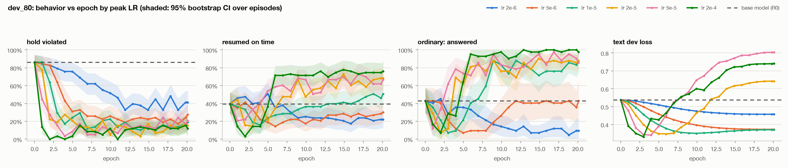
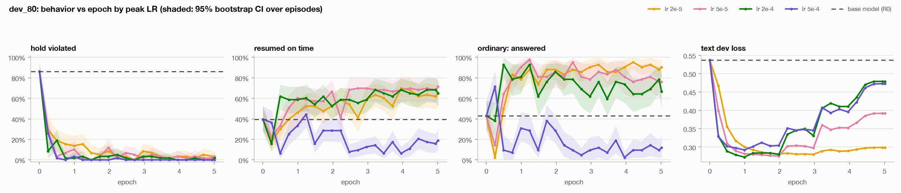
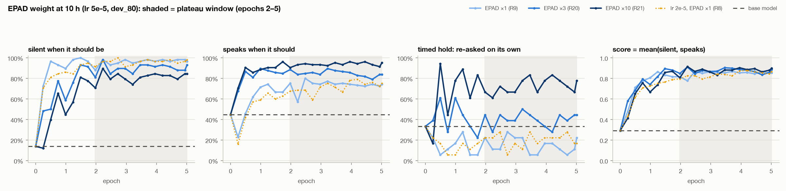

# How much synthetic data does it take to teach Moshi when to be quiet?

*Draft, 2026-10-15. Numbers come from `docs/training_record.md` and `results/*/summary.md`; history in
`docs/experiment_history.md`. Items marked **TODO** are still open.*

## Summary

- **Conditional silence is learnable from very little synthetic data.** A LoRA fine-tune of
  `kyutai/moshiko-pytorch-bf16` on **1 hour** of synthetic conversations (113 episodes, ~70 requested holds):
  - takes the share of requested holds Moshi keeps silent from **14% to ~90%**;
  - raises cue-released resumes ("I'm back") from 47% to ~96% on time;
  - raises answers to ordinary questions from 43% to ~98%.

  The silence is produced by the model itself; there's no mute rule.
- **10 hours is the useful size; 50 hours did not help.** The 10 h model (R21) is the best on every held-out
  suite but one. Its balanced score on scripts it never saw is 0.97, against 0.32 for the base model.
  Against the 1 h model, it adds +4–6 points on new scripts, voices, wording and distractors. A 50 h set built
  with a changed recipe scored 2–6 points *below* 10 h. We attribute that to the recipe, not the size (§5.3).
- **Behavior is set by optimizer steps, not unique data.** At every data size the behavior plateaus after
  **~70 optimizer steps (~1,100 conversations seen)**. More unique data mostly buys robustness (lookalike cues,
  new voices) rather than faster learning.
- **Learning rate is the main lever, and both ends fail the same way: a model that is too quiet.**
  - Too low an LR (≤ 5e-6 at 1 h) learns "be quiet" but never "speak again".
  - Too high (5e-4 at 10 h) collapses into silence.
  - The best LR drops as data grows: 2e-4 at 1 h, 2e-5–5e-5 at 10 h.
- **The training objective is biased toward silence, and fixing that is what made timed holds work.** The
  "start talking now" token carries ~0.6% of the text loss. Up-weighting it ×10 is what finally taught
  "give me ten seconds, then ask me again" (re-asks 15% → 73%), at some cost to silence *inside* timed holds.
- **What generalized:**
  - new scripts and new voices;
  - questions addressed to the other person;
  - pauses before the speaker is done;
  - phrases resembling the return cue, including the friend (not the user) saying "I'm back" (10 h: silent 18/18).
- **What failed:**
  - timed holds with new wording or new durations;
  - holds longer than anything trained ("a minute");
  - releases by a new kind of cue (a keyword, the end of a phone call).

**Estimate of data requirements** (for this generator, LoRA r = 64):

| Data | What it gets you |
|---|---|
| ~1 h unique (~100 episodes, ~70 holds) | Enough to learn cue-released silence |
| ~10 h unique | Robust to lookalike cues and new voices |
| > 10 h of the same kind | No further gain |

Timed holds need loss reweighting, not more data. Each setting needs only ~1,100 episode presentations of
training (~70 steps at batch 16).

---

## 1. Task and behaviors

We taught three "wait" behaviors and kept ordinary conversation in the mix:

| Family | Example instruction | Release | Share of train episodes |
|---|---|---|---|
| **B1 timed hold** | "Give me ten seconds to think, then ask me again." | Moshi re-asks after N s, unprompted | 15% (std 9, two holds in one episode 2, early answer 2, rescind 2) |
| **B2 side conversation** | "I'm going to talk to my friend. Stay quiet until I tell you I'm back." | User's return cue | 25% |
| **B3 hear me out** | "Let me describe all three options before you comment." | User signals they're done | 20% (std 16, finishes early 2, rescind 2) |
| **Ordinary** | Normal Q&A; ⅓ of user turns contain a 0.8–2 s mid-turn pause | Answer within ~3 s | 30% |
| **Decoy** | Hold-like words with no hold intent ("I just got back from Boston") | Answer normally | 10% |

The **contrast episodes** are early answer, rescind and finishes early. They exist so the model learns to
follow the instruction rather than "go deaf for a while".

**Distractors** are written into the scripts in context:
- a question from the friend to the user (D1a), from the user to the friend (D1b), or one that could be for
  Moshi (D1c);
- stalls of 2–8 s mid side-conversation (D2a);
- pauses between options (D2b);
- the user muttering during a timed hold (D2c);
- return-cue lookalikes (D3a / D3b);
- the friend saying "Okay, I'm back" (D4, test only).

## 2. Data

### 2.1 Generation (`silence/`)

1. **Scripts ("content packs")** are written by Claude Sonnet 5.5: 2,500 packs, 500 per family, ≈ $9.50.
   - Structured outputs, with a schema and length validator.
   - Speakability filters: no brands, acronyms or rare words. Pocket TTS garbles them.
   - Near-duplicate removal.
   - 15% of packs held out by hash for test.
2. **Instruction wording** comes from phrase banks with separate train and test lists. Return cues, timed-hold
   durations and friend names are also split train/test.
3. **TTS:** Kyutai's Pocket TTS, 16 training voices and 4 held-out voices; Moshi is always the voice `michael`.
   The 50 h set added ElevenLabs Flash and Fish Audio voices (§5.3).
4. **Assembly:** a stereo 24 kHz file per conversation.
   - **Left** = Moshi: scripted replies, digital silence while it should wait.
   - **Right** = user + friend + noise.
   - The friend is −9 to −4 dB with synthetic reverb. Noise is at 15–35 dB SNR.
   - Turn gaps are lognormal; Moshi's reply gaps are 0.45–1.35 s.
   - Every episode is ≤ 60 s, so it fits exactly one training window and every hold has its instruction in context.
   - The user always speaks first.
5. **`check.py` verifies each episode with moshi-finetune's own tokenizer.**
   - Silence during holds.
   - Word/audio alignment within 0.15 s.
   - Timer accuracy.
   - Cue latency.
   - An EPAD (start-of-speech) token right before each resume.
   - No overlap.

   All 1,150 train, 200 dev and 630 test episodes pass.

### 2.2 Unique data vs. exposure

Unique data and repetition are reported separately (`make_splits` ledger). "Seen" = episode presentations
during training: one presentation = one 60 s window; shorter episodes are padded and the padding is masked.

| Set | Episodes | Unique scripts | TTS clips | Total h | Speech h | Moshi speech h | Hold-silence h |
|---|---|---|---|---|---|---|---|
| train_1h | 113 | 116 | 885 | 1.01 | 0.70 | 0.25 | 0.39 |
| train_10h | 1,101 | 1,135 | 8,463 | 10.01 | 7.05 | 2.48 | 3.73 |
| train50 `train_50h` | 5,457 | 5,664 | 39,968 | 50.00 | 34.98 | 12.89 | 17.12 |
| dev_80 / dev_200 | 80 / 200 | — | — | 0.77 / 1.97 | | | |
| 7 test suites | 7 × 90 | 348 held-out packs | — | 6.1 | | | |

No script is reused within a training set, so unique episodes ≈ unique scripts.

| Model | Unique data | Steps × batch | Presentations | Epochs | Audio seen |
|---|---|---|---|---|---|
| 1 h, full run | 1.01 h | 142 × 16 | 2,272 | 20.1 | ≈ 20 h |
| 1 h ×10, best (R17, ckpt 42) | 1.01 h | 42 × 16 | 672 | 5.9 | ≈ 6 h |
| 10 h, full run | 10.0 h | 345 × 16 | 5,520 | 5.0 | ≈ 50 h |
| 10 h ×10, best (R21, ckpt 153) | 10.0 h | 153 × 16 | 2,448 | 2.2 | ≈ 22 h |
| 50 h (R22) | 50.0 h | 345 × 16 | 5,520 | 1.0 | ≈ 51 h |

R21 and R22 have identical training compute, so the 10 h vs 50 h comparison holds compute fixed.

## 3. Training

- **Base:** `kyutai/moshiko-pytorch-bf16` @ `2bfc9ae`, the same starting checkpoint for every run.
- **Code:** `kyutai-labs/moshi-finetune` @ `2acc879` plus four small patches (`patches/`):
  1. **audio-mask**: no audio loss on Moshi's *speech* frames, so it doesn't learn to sound like the TTS voice.
  2. **eval-reload**: the upstream dev loss is NaN after the first evaluation; this fixes it.
  3. **text-tail**: padding after the end of a short file was ~46% of the text-loss frames at 1 h; this removes it.
  4. **loss-weights**: an optional separate weight for the EPAD ("start talking") token.
- **Recipe:**
  - LoRA rank 64, scaling 2, on all linear layers.
  - Batch 16 × 60 s windows; AdamW (wd 0.1); OneCycle schedule (5% warmup, cosine to 0).
  - Text loss plus audio loss over Moshi's 8 codebooks (first codebook ×100); PAD and EPAD weighted 0.5.
  - Seed 0, one H100 per run.
- **Speed:** ~10 s/step; one 1 h run (20 epochs) took ~35 min.
- **Fixed epochs per phase:** 1 h runs got 20 epochs with a checkpoint every epoch; 10 h runs got 5 epochs
  with a checkpoint every ¼ epoch. Every checkpoint was evaluated. A mid-run checkpoint is a snapshot of a
  longer OneCycle schedule, not a shorter run.

## 4. Evaluation

**Generation, not loss.**
- For each test conversation, the model generates Moshi's channel live against the recorded user channel.
- Outside the scored windows, Moshi's text and audio are forced to the script, so every hold is scored, not
  just the first.
- The user stream is fed one frame later than a naive replay. This makes the model's inputs integer-identical
  to training (verified on the 7B: 100% of input columns).
- The output is decoded with Mimi; Silero VAD gives speech timing and Moshi's text stream gives its words.
  1 sample per episode, with the same seed per episode for every model.

**Metrics:**
- **Silent when due:** no ≥ 1 s of speech or > 3 words inside a hold, after a 2.5 s grace period for an
  acknowledgment.
- **Speaks when due:** a new onset at the release: the cue, N seconds after a timed hold, or an ordinary question.
- **Score** = the mean of the two. Reported together because each alone rewards a degenerate model (always
  quiet, or always talking).
- **Also:** on time (within max(1.5 s, 0.2 N) of the release), cue latency, timer error, and reactions to
  each distractor type.

**Sets:**
- **dev_80 / dev_200:** training voices and wording, unseen scripts. Used for model selection.
- **7 held-out test suites, 90 episodes each**, each holding out one axis:

  | Suite | Held out |
  |---|---|
  | test_script | new scripts |
  | test_word | new instruction wording + new hold durations (8 / 12 / 25 s) |
  | test_voice | 4 unseen voices |
  | test_distract | dense distractors + the friend saying "I'm back" |
  | test_cond | new waiting conditions: keyword release ("pineapple"), phone call, "a minute" |
  | test_ordinary | ordinary conversation only |
  | test_all | new scripts + wording + voices |

**Selection rule:** best dev_80 score.

**Noise:** a single checkpoint's dev score is ±0.06; a test-suite number is ±10 points at n ≈ 50 holds.

**Dev loss** is logged but not used for selection: it ranks models almost backwards (§5.1).

## 5. Results

### 5.0 Baseline (unmodified Moshi, dev_80)

- It talks through 86% of requested holds.
- It resumes on time after 40% of releases.
- It answers 43% of ordinary questions.
- It starts talking over the user 56 times in 80 conversations.
- It reacts to 40–83% of distractors.

Score **0.29**.

### 5.1 Learning rate



Plateau averages (1 h: epochs 10–20; 10 h: epochs 2–5):

| Peak LR | 1 h score | 1 h silent / speaks | 10 h score | 10 h silent / speaks |
|---|---|---|---|---|
| 2e-6 | 0.40 | 60% / 21% | — | — |
| 5e-6 | 0.55 | 77% / 33% | — | — |
| 1e-5 | 0.71 | 85% / 58% | — | — |
| 2e-5 | 0.79 | 88% / 70% | 0.84 | 96% / 72% |
| 5e-5 | 0.79 | 84% / 73% | **0.85** | 96% / 74% |
| 2e-4 | **0.86** | 89% / 83% | 0.82 | 98% / 66% |
| 5e-4 | — | — | 0.57 | 100% / 14% |

- **Two phases of learning.** Every run first learns to be quiet (silence up, answers *down*), then learns
  when to speak again. Too low an LR never leaves the first phase.
- **The best LR moves down with more data.** 2e-4 is best at 1 h and slightly worse at 10 h; 5e-4 at 10 h
  collapses into a silent model.
- **Dev loss is misleading.** At 1 h, dev text loss bottoms at epoch 3–4 and then doubles (the model memorizes
  the scripts' wording). Behavior keeps improving through epoch 20, and the lowest-loss LRs behave worst.
  The lowest-dev-loss checkpoints mostly stay silent and never resume (audible in the demo).

### 5.2 Data size



**TODO:** one figure of score vs unique hours (1 / 10 / 50) at matched settings, with exposure on a second axis.

**On dev (in-distribution), 1 h and 10 h tie.**
- Best checkpoints are 0.86–0.90 at 1 h and 0.87–0.91 at 10 h.
- 10 h holds silence better (96–98% vs 84–89%) but speaks again less readily.
- **The plateau arrives after ~70 optimizer steps (~1,100 presentations) at both sizes.** That is 10 epochs at
  1 h and about 1 epoch at 10 h.

**The value of 10 h shows up on held-out data and lookalikes.**
- On a side conversation where the user tells the friend "Okay, I'm done for today anyway", every 1 h model
  says "Welcome back!" ~16 s early. The 10 h model waits for the real cue, then says *"Welcome back! About your
  sister's clay sculpture, what shape are you thinking of?"*
- On the friend-says-"I'm back" test (D4), the 10 h model stays silent 18/18 times, the 1 h model 10/18.

### 5.3 Loss reweighting: the silence bias

The objective is biased toward silence by construction:
- ~90% of Moshi's text targets are PAD ("stay silent").
- EPAD ("start talking now") is 0.6% of frames and ~0.6% of the text-loss weight.
- The audio loss only sees Moshi's silent frames, because its speech is masked.

This explains the "quiet first" learning phase, the over-cautious 10 h models, and why timed holds stayed
unlearned. A timed hold's release is the only speak moment with no human utterance before it. Without
reweighting, models re-asked after a timed hold only 8–26% of the time, below the base model's 33%.

Up-weighting EPAD (×3 … ×100, `text_epad_weight`):

| Setting | Plateau score | Silent | Speaks | Timed re-ask |
|---|---|---|---|---|
| 1 h, ×1 → ×10 | 0.80 → 0.80 | 86% → 78% | 73% → 83% | 15% → 34% (60–80% mid-training) |
| 10 h, ×1 → ×3 → ×10 | 0.85 → 0.87 → **0.88** | 96% → 90% → 81% | 74% → 85% → 94% | 15% → 40% → **73%** |



- At 1 h the weight is a dial along a silence/speech trade-off.
- At 10 h, where the baseline was over-silent, it is a net gain, and the timed re-ask *sticks*: 61–83% at
  every checkpoint after epoch 2.
- The silence it costs is almost all inside timed holds. Side-conversation and hear-me-out holds stay 97–99%
  silent.
- **R21 (10 h, lr 5e-5, EPAD ×10, epoch 2.2) is our best model.**

**50 h (R22)** used the same settings and compute as R21 on a new 51 h set (5,585 episodes). The new set
changed more than size:
- 5,164 new scripts, screened against dev/test;
- user and friend voices from three TTS engines (63 voices);
- a mix shifted toward timed holds (25% vs 15%), with fillers in 70% of them.

It did **not** beat 10 h. Dev score was ≈ 0.83 vs 0.88, and it was 2–6 points lower on 6 of 7 test suites.
Silence broke down in exactly the holds with long pauses:

| Hold type | R21 silent | R22 silent |
|---|---|---|
| Hear-me-out, rescinded | 85% | 15% |
| Two timed holds in one episode | 70% | 20% |
| Timed hold, rescinded | 95% | 40% |

Side conversations stayed at 98%. Our reading: more timed holds plus ×10 taught the shortcut "after a few
seconds of silence, start talking". That is a recipe effect: size and recipe are confounded here (§7).

### 5.4 Generalization (held-out test suites)

Score (silent / speaks); 1 sample per episode.

| Suite | Base | 1 h ×10 (R17) | **10 h ×10 (R21)** | 50 h ×10 (R22) |
|---|---|---|---|---|
| test_script: new scripts | 0.32 (6% / 57%) | 0.93 (96% / 90%) | **0.97** (98% / 96%) | 0.93 (90% / 97%) |
| test_word: new wording, durations | 0.35 (11% / 59%) | 0.82 (74% / 90%) | **0.87** (81% / 93%) | 0.84 (72% / 95%) |
| test_voice: unseen voices | 0.37 (16% / 57%) | 0.86 (82% / 90%) | **0.92** (89% / 95%) | 0.89 (82% / 96%) |
| test_distract: dense distractors | 0.29 (3% / 56%) | 0.93 (87% / 100%) | **0.98** (99% / 97%) | 0.92 (89% / 94%) |
| test_cond: new conditions | 0.32 (6% / 58%) | 0.67 (46% / 89%) | **0.72** (66% / 79%) | 0.70 (49% / 91%) |
| test_ordinary | 0.59 | 0.96 | 0.98 | **1.00** |
| test_all: all held out | 0.32 (14% / 50%) | 0.79 (70% / 88%) | **0.84** (77% / 91%) | 0.80 (67% / 93%) |

**Generalized:**
- New scripts score like dev.
- Unseen voices cost ~5 points.
- **Distractors are essentially solved at 10 h**: 0% reactions to questions between the humans, stalls,
  option pauses and cue lookalikes (base 52–100%).
- Ordinary questions are still answered (98–100%), so the model did not just become quiet.
- New wording costs ~10 points overall, almost all of it in timed holds.

**Did not generalize:**
- **Timed holds with new wording or new durations**: 0–50% silent in some suites, though n is only 4–10
  per cell.
- **Holds longer than any trained**: "a minute" holds are silent 7% of the time. The longest trained hold is
  30 s, and these episodes run past the 60 s training window.
- **New release cues**: keyword ("pineapple") and phone-call holds are *kept* (97% / 94% silent), but Moshi
  spoke at only 68% of those releases.

### 5.5 Failure modes heard in the audio

- **Answering the user's own filler during a timed hold.** On "Well now, that's a toss-up", strong
  non-EPAD models reply; EPAD ×10 stays silent and then re-asks.
- **Early "Welcome back!"** at return-cue lookalikes (1 h models).
- **Quiet models** (too low or too high an LR): hold perfectly and never come back.
- **Bimodal timing on timed holds** (R21): of 11 timed holds on dev, 5 re-ask too early (e.g. after 3–4 s of
  a 15 s hold) and 6 never re-ask.

## 6. Demo and audio examples

- **`results/demo_curated/index.html`**: 9 conversations × 9 representative models. Each has the audio
  (Moshi left / user right), a timeline marking the requested silence and the release, the scored outcome,
  and Moshi's generated words.
- **`results/transcripts.html`**: the same conversations as readable transcripts, with a click-to-seek player.
- **`results/demo/index.html`**: base + every 1 h / 10 h run at its lowest-dev-loss and final checkpoints.
- **Live chat:** `python -m silence.chat_gui` runs two checkpoints side by side on one GPU, with 13 test
  scripts (`results/chat/test_scripts.md`).

**TODO:** pick 4–6 clips for the report:
- one side-conversation success;
- the lookalike-cue contrast between 1 h and 10 h;
- a timed-hold success (R21) and a timed-hold failure;
- the friend saying "I'm back";
- one ordinary conversation.

**TODO:** a listening log (successes and failures, by ear).

Serve the pages with `cd results && python3 -m http.server 8780`.

## 7. Limitations and what we did not do

- **No human-recorded test set yet.** Every number is on synthetic audio. **TODO:** ~40 recorded episodes
  labeled with the same event schema; this is the main open item.
- **100 h and 1,000 h not run.** We went to 50 h instead, with a changed recipe, so we have no clean size
  curve beyond 10 h. The clean comparisons are:
  - R23: the 50 h recipe at 10 h, to separate recipe from size;
  - the v3 fix (§8).
- **The "talk about trees" experiment was not run.**
- **Statistics:**
  - 1 seed;
  - 1 sample per episode (3 were planned for the final tests);
  - the best checkpoints were picked on dev_80 out of 21 per run, which flatters them slightly; a dev_200
    re-check was planned but not run;
  - the test suites aren't paired, so differences *between suites* mix the held-out axis with script and
    type-mix differences.
- **Moshi's own voice:** in training, Moshi's side is a TTS voice; its audio loss is masked to avoid
  imitating it, but its text is trained on our scripts.
- **Held-out voices** in the test suites are 4 Pocket voices. The held-out ElevenLabs and Fish voices
  aren't in any suite yet.
- **Not built:** Whisper-based content scoring and an LLM judge of response appropriateness. The "speaks"
  metric checks timing, not what was said.

## 8. Next experiment

**Break the "talk after a pause" shortcut, then measure size cleanly.**
- Rebuild the 50 h set as v3 (same audio, only timing and mix change):
  - timed holds back to 15%;
  - long silences inside cue-released holds (side-conversation stalls up to ~20 s, hear-me-out pauses up to
    ~12 s), so "silence lasted a while" stops predicting "speak now".
- Train v3 at 10 h and 50 h with identical compute, EPAD ×10.
- Prediction: 50 h v3 ≥ R21, especially on test_word / test_all timed holds.
- Then record the human test set and evaluate R21 and the best v3 model on it.

## 9. Reproducing

**Pins:**
- `kyutai/moshiko-pytorch-bf16` @ `2bfc9ae6e89079a5cc7ed2a68436010d91a3d289`
- moshi-finetune @ `2acc879f` + `patches/*.patch`
- environment from moshi-finetune's `uv.lock`: torch 2.6.0, moshi `061cc4c`

```bash
# data (Mac/CPU; packs need ANTHROPIC_API_KEY)
python -m silence.gen_packs --out packs/packs.jsonl --per-family 500
python -m silence.build train --packs packs/packs.jsonl --n 1150 --out data/train
python -m silence.make_splits data/train --hours 1 10
python -m silence.build_dev --exclude data/train --out data/dev
python -m silence.screen_packs --split test --against data/train data/dev --out packs/packs_test_screened.jsonl
for s in test_script test_word test_voice test_distract test_cond test_ordinary test_all; do
  python -m silence.build $s --packs packs/packs_test_screened.jsonl --n 90 --out data/$s; done
python -m silence.check data/train

# GPU: env + patches + weights + configs + smoke test, then one run per GPU
bash scripts/gpu_bootstrap.sh
bash scripts/run_parallel.sh configs/R0_devloss.yaml configs/R?_1h_*.yaml
bash scripts/eval_dev.sh dev_80 R0 R1_1h_lr2e-06 …
bash scripts/test_suites.sh            # held-out suites
```

**Compute:** about 24 H100-hours over the project. Spend ≈ $135 all-in: GPUs ≈ $95 at $3.99/hr; Claude
scripts ≈ $30; TTS APIs ≈ $9. A single 10 h run plus its evaluation is ~1.5 H100-hours ≈ $6.

## Appendix: run index

| Run | Data | Peak LR | EPAD × | Steps | Plateau score (dev_80) |
|---|---|---|---|---|---|
| R0 | — | — | — | — | 0.29 (base) |
| R1, R6, R2, R7, R3, R4 | 1 h | 2e-6, 5e-6, 1e-5, 2e-5, 5e-5, 2e-4 | 1 | 142 | 0.40, 0.55, 0.71, 0.79, 0.79, 0.86 |
| R8–R11 | 10 h | 2e-5, 5e-5, 2e-4, 5e-4 | 1 | 345 | 0.84, 0.85, 0.82, 0.57 |
| R16–R19 | 1 h | 5e-5 | 3, 10, 30, 100 | 133 (disk-full crash) | 0.81, 0.80, 0.77, 0.80 |
| R20, R21 | 10 h | 5e-5 | 3, 10 | 345 | 0.87, 0.88 |
| R22 | 50 h (v2 recipe) | 5e-5 | 10 | 345 | ≈ 0.83 |
